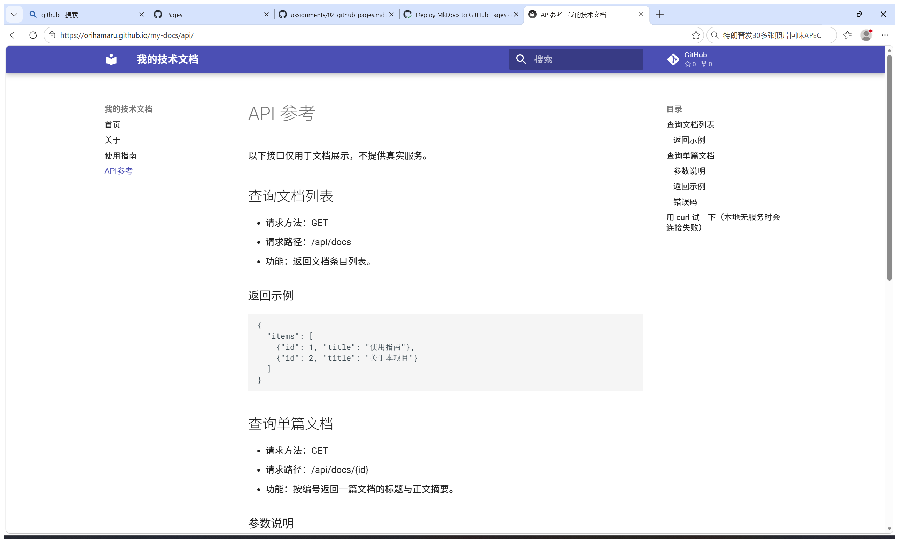

# 实践项目2：个人实验报告

## 1. 基本信息

- GitHub 登录名：orihamaru
- 个人仓库地址：https://github.com/orihamaru/my-docs
- 最终网站地址：https://orihamaru.github.io/my-docs/

## 2. 实践过程与关键截图

### 2.1 仓库创建

在本人 GitHub 账号下创建公开仓库 `my-docs`，默认分支 `main`，克隆到本地后开始编写文档。

### 2.2 项目结构与 MkDocs 配置

见截图②。`docs/` 存放手写的四页 Markdown；`mkdocs.yml` 负责站点名称、`site_url` 和 `nav` 导航；`site/` 是 `mkdocs build` 生成的构建产物，因此写入 `.gitignore`，不进入版本库。

### 2.3 本地构建或预览

见截图③。先建虚拟环境安装依赖，再执行 `python -m mkdocs build --strict`（把警告当错误）与 `python -m mkdocs serve` 本地预览。

### 2.4 Pages 设置

见截图④。在 Settings → Pages → Build and deployment 中把 Source 设为 **GitHub Actions**，不使用从分支发布。

### 2.5 Actions 首次构建和部署

见截图⑤。推送后工作流 `Deploy MkDocs to GitHub Pages` 自动运行，`build` 与 `deploy` 两个任务均成功。

### 2.6 网站访问与四页导航检查

见截图⑥。打开 https://orihamaru.github.io/my-docs/ ，逐一检查首页、关于、使用指南、API 参考四页的导航、表格、代码块与页间链接。

### 2.7 第二次推送与自动更新验证

见截图⑦。在 `docs/index.md` 末尾增加一句可辨认的文字，提交推送后由 push 自动触发新的运行，网站刷新后出现新增文字。

- 对应提交链接：待填
- 对应 Actions 运行链接：待填

## 3. 问题与解决

（待补充：实际现象、关键日志、原因与解决操作）

## 4. 原理理解

1. **docs/ 和 site/ 各保存什么？为什么不用手工修改 site/？**
   `docs/` 是人写的 Markdown 源码，是唯一需要维护的内容；`site/` 是 `mkdocs build` 生成的 HTML/CSS/JS 与搜索索引，属于可再生的构建产物。手工改 `site/` 会在下一次构建时被覆盖，而且它不在版本库里，所以正确做法是改 `docs/` 再重新构建。

2. **本次工作流在什么情况下自动运行？**
   只有当 `main` 分支上 `docs/**`、`mkdocs.yml`、`requirements.txt` 或 `.github/workflows/deploy.yml` 发生变更时才触发；此外支持 `workflow_dispatch` 手动运行。

3. **build 与 deploy 两个任务有什么区别？**
   `build` 在 ubuntu 上检出代码、装 Python 与依赖、执行 `mkdocs build --strict`，并上传 `site/` 作为 artifact；`deploy` 通过 `needs: build` 在构建成功后运行，拿到 `pages: write`、`id-token: write` 权限，用官方 `deploy-pages` 把 artifact 发布到 `github-pages` 环境。

4. **只修改 report/README.md 会触发部署吗？为什么？**
   不会。工作流的 `paths` 只包含 `docs/**`、`mkdocs.yml`、`requirements.txt` 和工作流文件本身，`report/**` 不在其中，所以改报告不会触发构建部署——报告与站点内容是分开的。

5. **本次方案为何无需创建 gh-pages 分支？**
   因为使用了 GitHub 官方的 Pages Actions 流程：`upload-pages-artifact` 把构建产物作为 artifact 上传，`deploy-pages` 直接发布到 Pages，由 Pages 的 `build_type=workflow` 承接，不需要像分支发布那样维护 `gh-pages` 分支。
