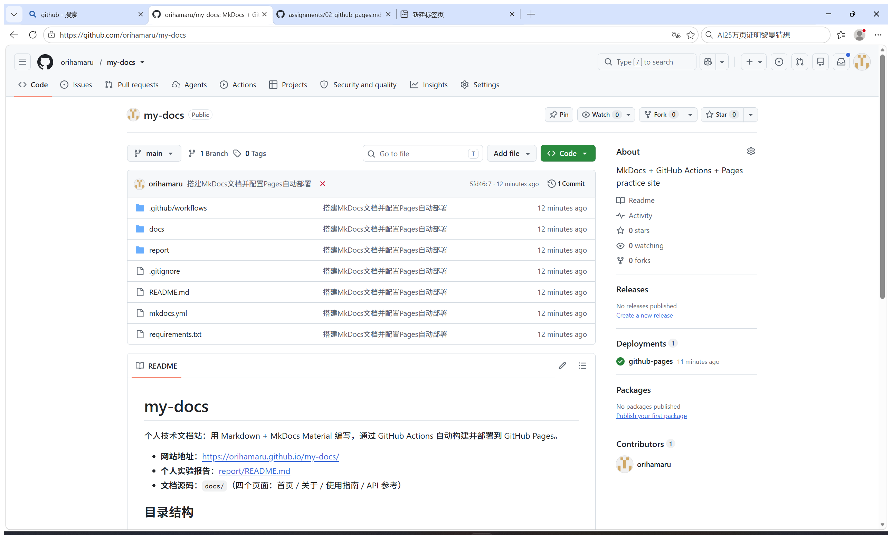
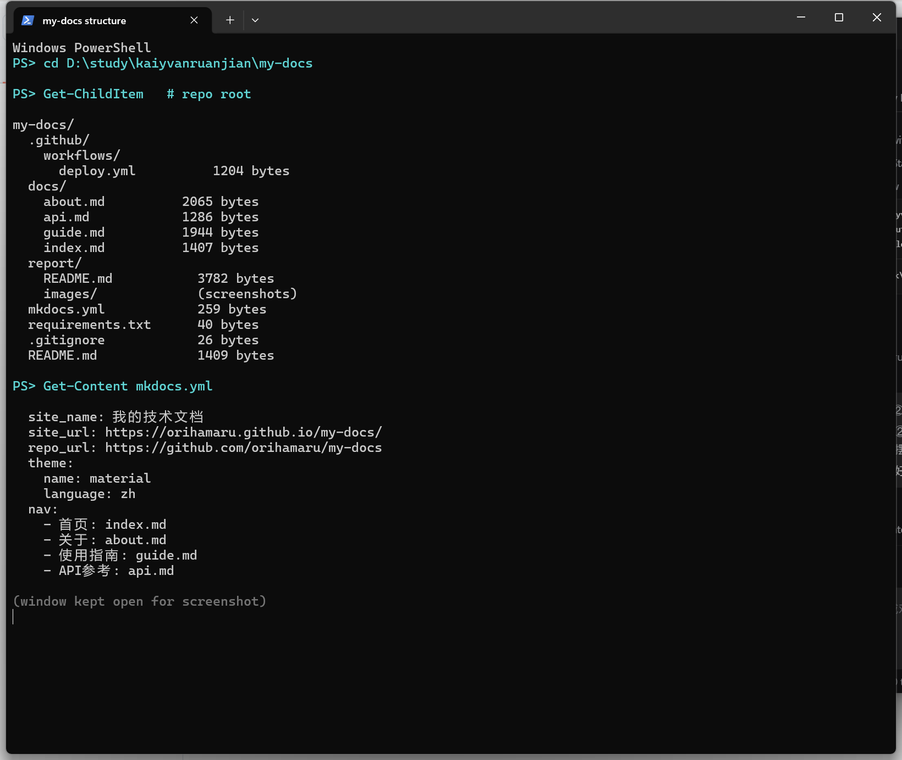
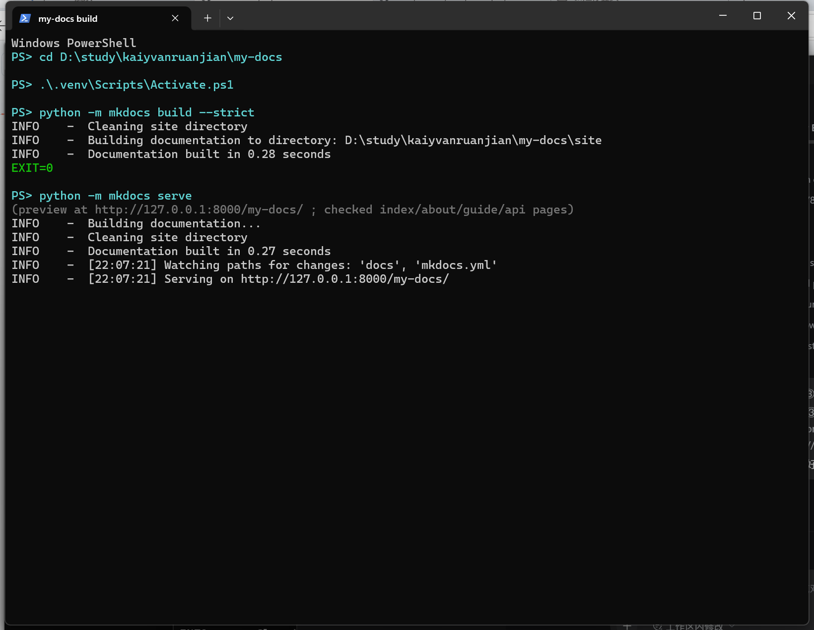
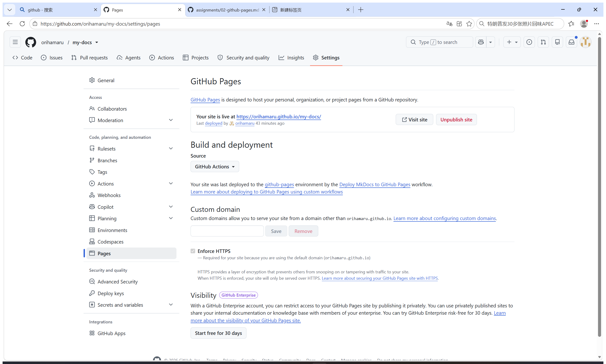
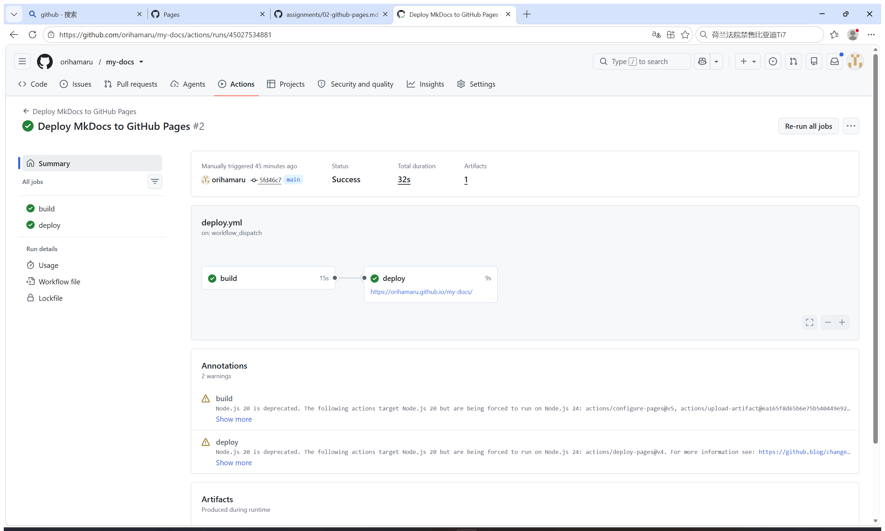
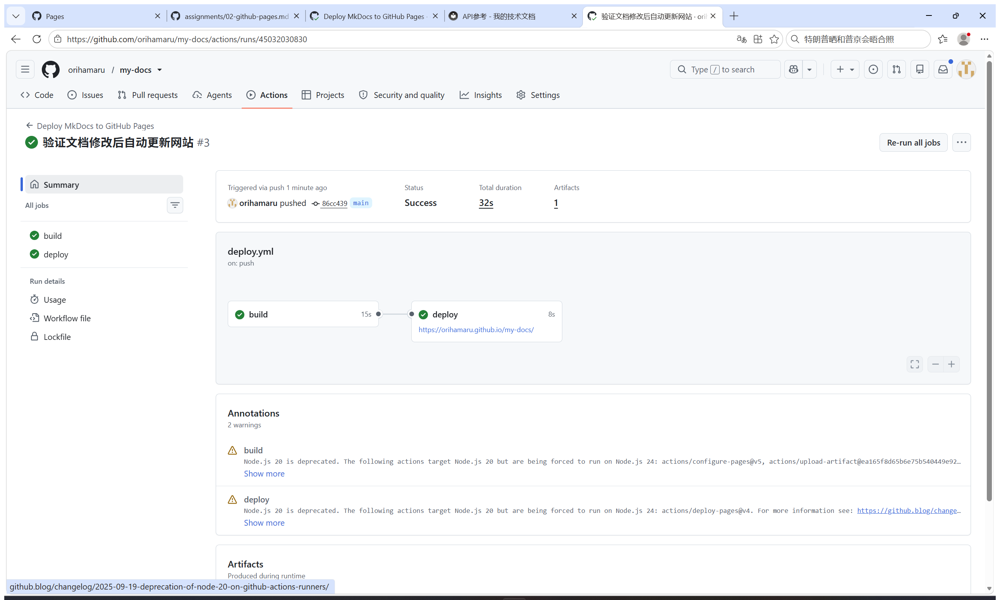
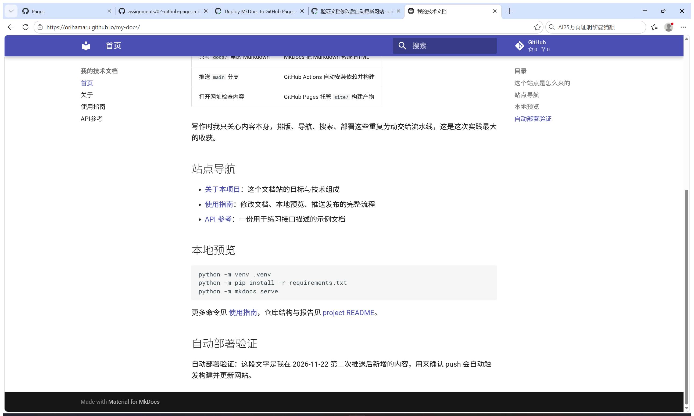

# 实践项目2：个人实验报告

## 1. 基本信息

- GitHub 登录名：orihamaru
- 个人仓库地址：https://github.com/orihamaru/my-docs
- 最终网站地址：https://orihamaru.github.io/my-docs/

## 2. 实践过程与关键截图

### 2.1 仓库创建

在GitHub账号下创建公开仓库 `my-docs`（Public，默认分支 `main`），把本地文档、配置和工作流推送到该仓库。
截图①能看到仓库所有者 `orihamaru`、仓库名 `my-docs` 与 `Public` 标识。

### 2.2 项目结构与 MkDocs 配置

截图②展示了仓库结构和 `mkdocs.yml`。`docs/` 里是四页 Markdown（首页、关于、使用指南、API 参考），`mkdocs.yml` 里的 `nav` 决定左侧导航顺序（路径相对于 `docs/`），`site_url` 决定构建后生成链接与 `sitemap` 的前缀；`site/` 是构建产物。

### 2.3 本地构建或预览

截图③是本地构建与预览。先 `python -m venv .venv` 建虚拟环境并安装 `requirements.txt`，然后：

- `python -m mkdocs serve`：输出 `Serving on http://127.0.0.1:8000/my-docs/`在浏览器逐个打开了四页均可正常运行，检查了导航高亮、表格、代码块和页间链接

### 2.4 Pages 设置

截图④是 Settings → Pages。Build and deployment 的 Source 选择GitHub Actions。页面上同时显示 `Your site is live at https://orihamaru.github.io/my-docs/`，说明 Pages 已按工作流发布过。

### 2.5 Actions 首次构建和部署

第一次由 push 触发的运行失败，原因和解决写在「3. 问题与解决」里；修好Pages设置后手动 Run workflow 跑通了这一条，后第二次push又验证了自动触发。

### 2.6 网站访问与四页导航检查

截图⑥是公开网站的实际效果，地址栏为 `https://orihamaru.github.io/my-docs/api/`,四页均打开检查可运行：

| 页面 | 地址 | 检查内容 |
| --- | --- | --- |
| 首页 | `/` | 表格、导航卡片、本地预览代码块 |
| 关于 | `/about/` | 技术组成表格、四部分链路说明 |
| 使用指南 | `/guide/` | 有序步骤、命令代码块、常见问题表格 |
| API 参考 | `/api/` | JSON 代码块、参数表、错误码表 |

导航均正常、页面间链接可点击。

### 2.7 第二次推送与自动更新验证

我在 `docs/index.md` 末尾加了一节「自动部署验证」，写了可辨认的一句话，提交推送后没有点手动部署，由 push 自动触发运行（#3，Success，32 秒），刷新网站后新增文字出现。

- 对应提交链接：https://github.com/orihamaru/my-docs/commit/86cc439d767bb1ddd5f090b1ed8c38d42d1004ca
- 对应 Actions 运行链接：https://github.com/orihamaru/my-docs/actions/runs/45032030830

## 3. 问题与解决

### 3.1 首次运行失败：Configure Pages 步骤报错

- 现象：第一次 push 后 Actions 自动运行，`build` 任务在第 4 步 `Configure Pages` 变红，`deploy` 被跳过；仓库提交记录旁显示红色叉叉。
- 关键日志：`actions/configure-pages@v5` 失败，日志提示无法获取 Pages 站点信息（仓库尚未启用 Pages）。
- 原因：先推了代码、后再去开Pages。`configure-pages` 与 `deploy-pages` 都要求仓库的 Pages 已经存在且 `build_type` 为 `workflow`。
- 解决：到 Settings → Pages 把 Source 设为 GitHub Actions（截图④），然后在 Actions 页面手动 `Run workflow`，运行 #2 成功（截图⑤）。此后 push 触发的运行也正常（#3），应该是启用顺序问题。

### 3.2 Node 20 弃用警告

- 现象：运行记录底部有 2 条 Annotation：`Node.js 20 is deprecated. The following actions target Node.js 20 but are being forced to run on Node.js 24: actions/configure-pages@v5, actions/upload-pages-artifact@..., actions/deploy-pages@v4`。
- 原因：GitHub 把仍在用 Node 20 的 Action 强制跑在 Node 24 上，属于平台侧升级提醒。
- 处理：这是警告不是错误，`build`、`deploy` 均成功；按要求保留了工作流的 `${{ ... }}` 表达式与官方 Action 版本，没有做多余改动。

## 4. 原理理解

1. docs/ 和 site/ 各保存什么？为什么不用手工修改 site/？
   `docs/` 是 Markdown 源码，是需要维护的内容；`site/` 是 `mkdocs build` 生成的 HTML、CSS、JS 和搜索索引，属于可再生的构建产物。
   手工改 `site/` 会在下一次构建时被覆盖，而且它在 `.gitignore` 里。

2. 本次工作流在什么情况下自动运行？
   只有当 `main` 分支上 `docs/**`、`mkdocs.yml`、`requirements.txt` 或 `.github/workflows/deploy.yml` 发生变更时，`on.push` 才触发；另外配置了 `workflow_dispatch` 可以在 Actions 页面手动运行（首次重试、排错用）。

3. build 与 deploy 两个任务有什么区别？
   `build` 在 `ubuntu-latest` 上检出源码、装 Python 3.12、装依赖、执行 `mkdocs build --strict`，并用 `upload-pages-artifact` 把 `site/` 作为 artifact 上传；
   `deploy` 通过 `needs: build` 在构建成功后才运行，拥有 `pages: write` 与 `id-token: write` 权限，用 `deploy-pages` 把 artifact 发布到 `github-pages` 环境并输出 `page_url`。构建失败时部署不会执行——这次 #1 就验证了这一点。

4. 只修改 report/README.md 会触发部署吗？为什么？
   不会。`paths` 只包含 `docs/**`、`mkdocs.yml`、`requirements.txt` 和工作流文件本身，`report/**` 不在其中。

5. 本次方案为何无需创建 gh-pages 分支？
   因为用的是 GitHub 官方的 Pages Actions 流程：产物以 artifact 形式在运行内传递（`upload-pages-artifact`），由 `deploy-pages` 直接发布到 Pages，仓库的 Pages 设置 `build_type` 为 `workflow`。分支发布方案才需要把 `site/` 推到 `gh-pages` 分支并让 Pages 从该分支读取。

- 截图文件全部放在 `report/images/`，本报告用相对路径引用，应该能看见吧（祈祷）