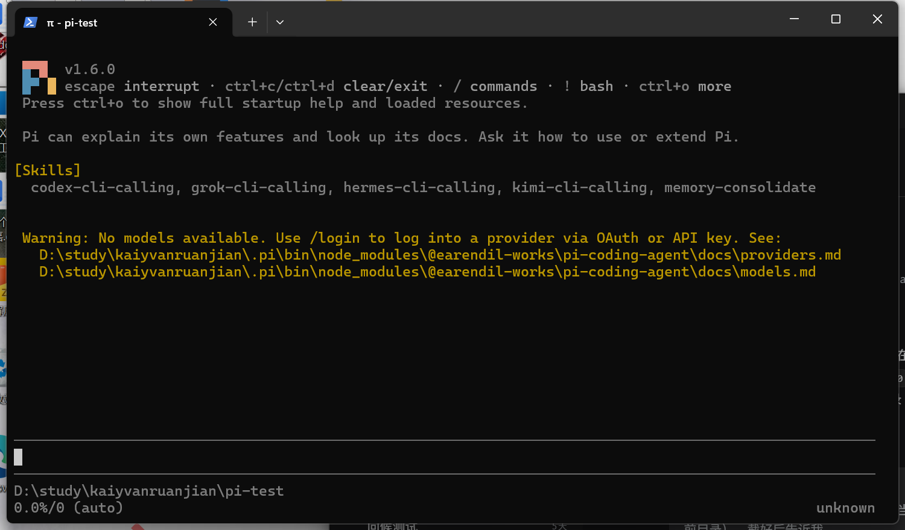
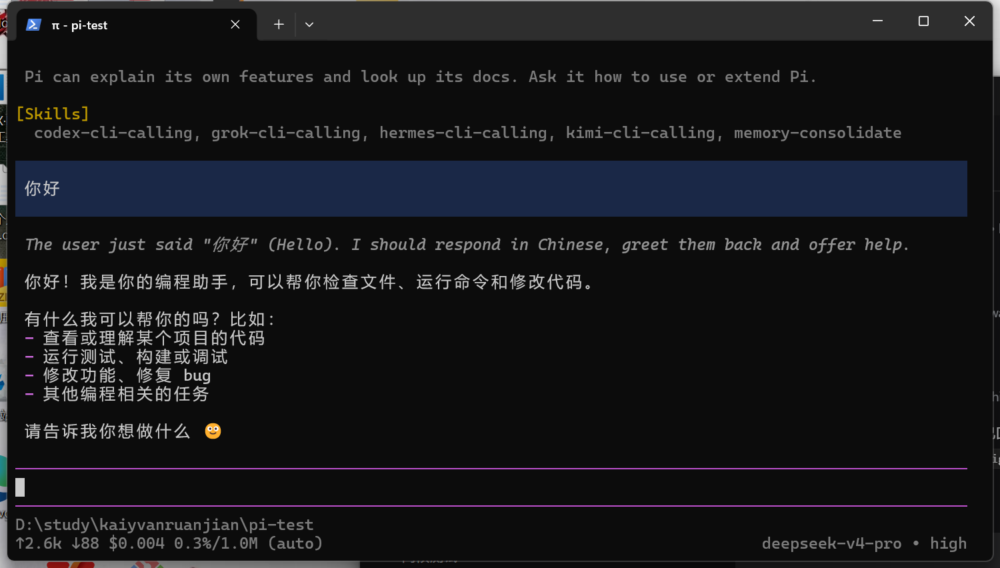
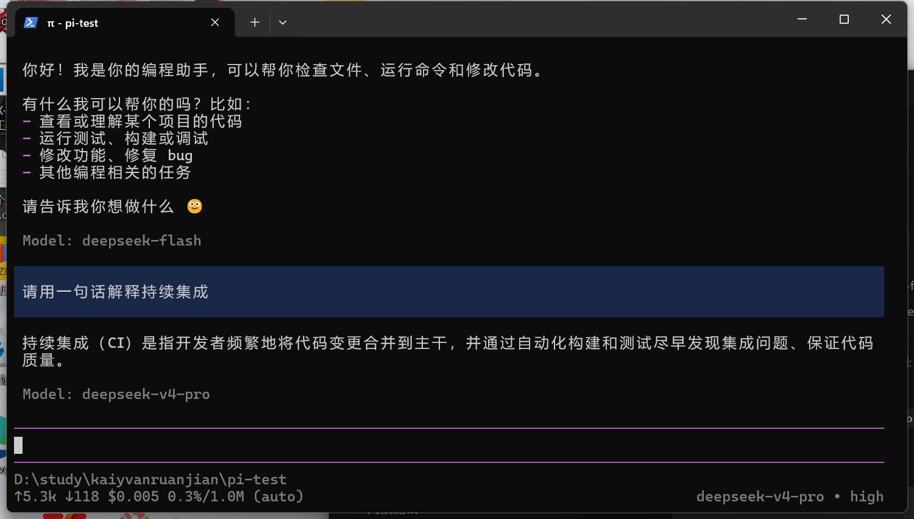
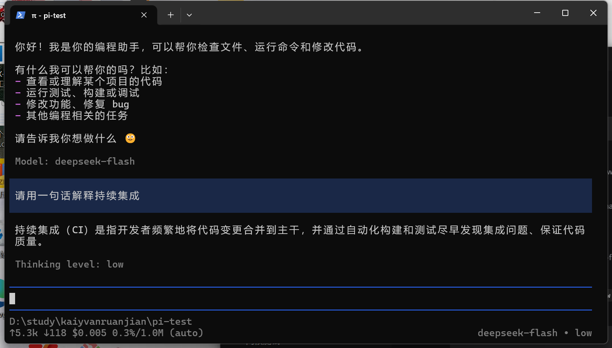
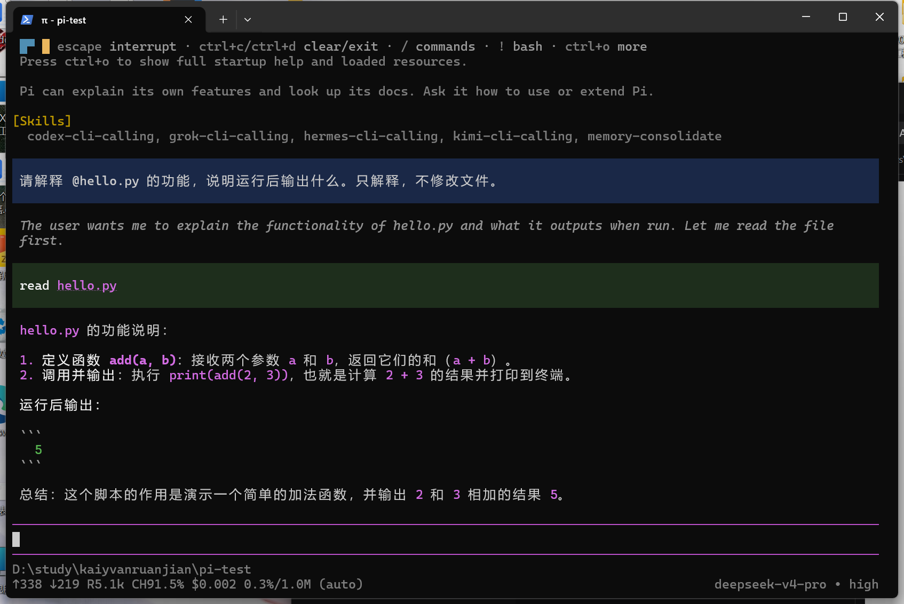
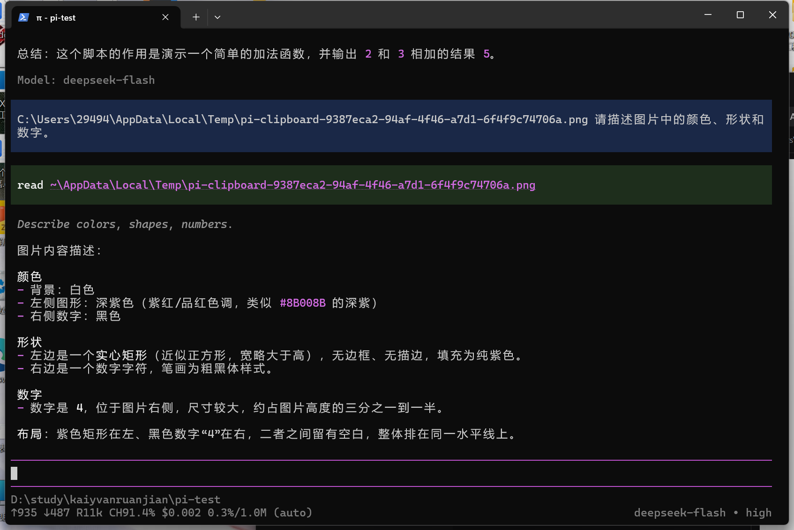
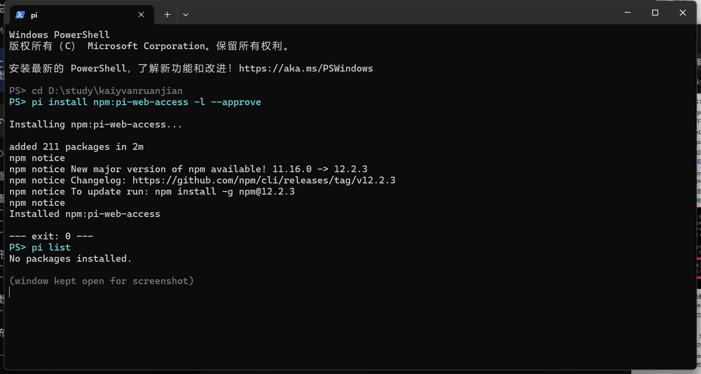
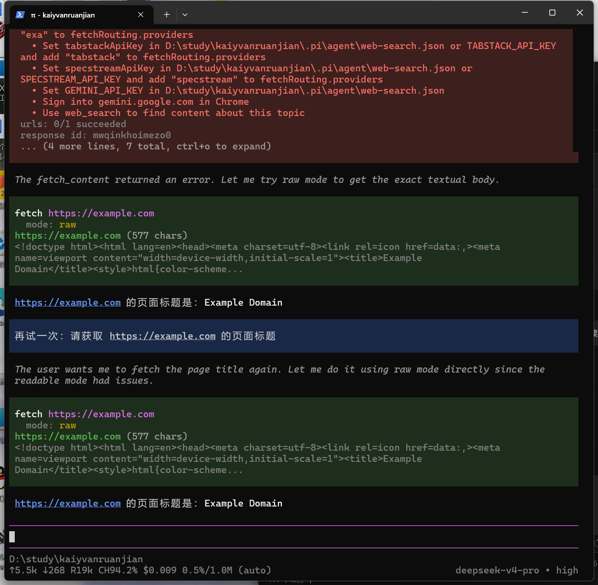
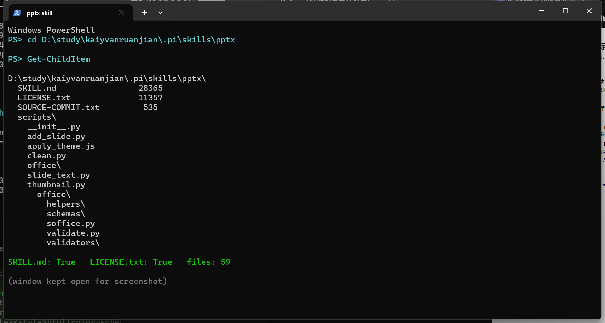
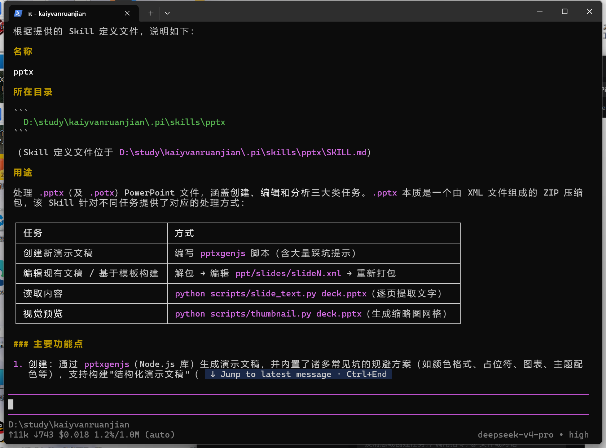

# 实践课1：Pi Agent 安装与使用

实践日期：2026-11-21　实践环境：Windows、Windows Terminal / PowerShell 5.1、Node.js v24.18.0、npm 11.16.0、Git 2.55.0、Pi v1.6.0　工作目录：`D:\study\kaiyvanruanjian\pi-test`

## 完成情况

| 任务 | 结果 | 截图 |
| --- | --- | --- |
| 安装并启动 Pi | 已完成，版本 1.6.0，工作目录正确 | S1 |
| 配置模型并会话 | 已完成，DeepSeek API Key | S2 |
| 切换模型和思考级别 | 已完成，切换后会话正常 | S3 |
| 引用代码、粘贴图片 | 已完成，输出 5；识别颜色形状和数字 4 | S4、S5 |
| 安装、加载并使用插件 | 已完成，pi-web-access 获取网页标题 | S6 |
| PPT Skill（实践） | 已完成，启动发现及调用见第六节 | S7、S8 |

## 一、本地安装并启动

本机已有 Node.js 与 Git，不需要安装器代装依赖。官方安装脚本 `install.ps1` 依赖 PowerShell 的 .NET/schannel 做 HTTPS 下载，在本机受限环境下报 `SEC_E_NO_CREDENTIALS`（拿不到凭据）而下载失败；Pi 官方 README 提供了等价的 npm 安装方式，因此改用 npm 安装到工作区：

```powershell
npm install -g --ignore-scripts --prefix D:\study\kaiyvanruanjian\.pi\bin @earendil-works/pi-coding-agent
cd D:\study\kaiyvanruanjian\pi-test
pi
```

安装正常结束，`pi --version` 输出 1.6.0，并能启动交互界面。截图包含版本和本次工作目录。本次安装的只是 Pi 客户端，模型权重并不部署到本机，调用的是 DeepSeek 的在线 API。

补充说明：Pi 启动时会用到 `fd`、`rg` 两个搜索工具，缺失时它会尝试自动下载；本机网络下该下载超时，所以把两个可执行文件放到了 `.pi\agent\bin`，此后启动不再报警。



## 二、配置模型并完成会话

在 Pi 中运行 `/login`，选择 DeepSeek，通过 API Key 完成配置。

配置完成后默认模型为 `deepseek-v4-pro`，发送「你好」，收到中文回复，底部状态栏显示当前模型与 token、费用信息。



## 三、切换模型和思考级别

先使用 `deepseek-v4-pro`，思考级别为 `high`，发送「请用一句话解释持续集成」，收到回复。

随后通过 `Ctrl+L`（等价于 `/model`）打开模型选择器，切换到 `deepseek-flash`；通过 `Shift+Tab`（等价于 `/thinking`）把思考级别由 `high` 调到 `low`。再次提问同一个问题，收到回复。

切换前 deepseek-v4-pro high
切换后 deepseek-flash low





简短回答：简单问答、短句解释可以用 `flash` 和较低思考级别，响应快、用量小；涉及多步推理、代码审查或复杂重构时，换用更强的模型并提高思考级别更稳妥，代价是等待时间和 token 用量上升。较高的思考级别不保证每次答案都更好，需要按任务复杂度权衡。

## 四、使用 @ 引用代码文件

在 `pi-test` 目录下创建 `hello.py`：

```python
def add(a, b):
    return a + b

print(add(2, 3))
```

在 Pi 的输入区输入 `@`，候选列表中出现 `hello.py`，选中后编辑器里会出现 `@hello.py`，再补上问题发送：「请解释 @hello.py 的功能，说明运行后输出什么。只解释，不修改文件。」

Pi 调用 `read` 工具读取文件，随后说明 `add(a, b)` 的用途，并确认运行后输出 `5`。截图里同时能看到引用的文件名、问题和实际回复。



## 五、粘贴小图片并测试

准备一张图片（白底、紫色实心矩形、右侧黑色数字 4），复制到剪贴板后，切换到支持图片输入的 `deepseek-flash`，在 Pi 输入区按 `Alt+V` 粘贴，再发送「请描述图片中的颜色、形状和数字。」

当前版本在 Windows 下的行为是：把剪贴板图片落成临时 PNG 文件，并在输入框插入该图片路径；发送后 Pi 用 `read` 工具读图。回复正确指出「白色背景、深紫色实心矩形（约 #8B008B）、黑色数字 4」，识别结果与原始图片一致。



测试用原始小图如下，便于核对识别结果：


## 六、安装、加载并使用插件

从 Pi Packages 目录（https://pi.dev/packages ）选择 `pi-web-access`（v0.48.0，作用：网页搜索、URL 抓取、PDF 与视频解析等）。该插件按项目级安装，安装到当前工作区：

```powershell
cd D:\study\kaiyvanruanjian
pi install npm:pi-web-access -l --approve
```

重新在终端单独运行 `pi`（首次需确认信任项目目录），启动页 `[Extensions]` 区域列出 `pi-web-access:dist`，插件已加载。



![重启后 [Extensions] 出现 pi-web-access:dist](images/s6-loaded.png)

功能试用：发送「请获取 https://example.com 的页面标题」，插件提供的 `fetch` 工具抓取页面（raw 模式，577 字符），给出结论「https://example.com 的页面标题是：Example Domain」。「加载成功」与「联网功能可用」这两件事分别由上面两张截图和这张截图记录。



## 七、AI 进行安装并调用 PPT Skill

从 `anthropics/skills`（main 分支，commit `e4bb5d9`）下载 `skills/pptx` 整个目录，安装到当前项目的 `.pi\skills\pptx`，共 59 个文件：`SKILL.md`、`LICENSE.txt`、`scripts/add_slide.py`、`scripts/thumbnail.py`、`scripts/clean.py`、`scripts/slide_text.py`、`scripts/apply_theme.js` 以及 `scripts/office/`（`soffice.py`、`validate.py`、`helpers/`、`schemas/`、`validators/`）。未使用 `pi install npm:pptx`，也没有自动安装依赖。



在 `D:\study\kaiyvanruanjian` 重新启动 `pi`，启动页 `[Skills]` 列表末尾出现 `pptx`，说明 Pi 从项目 `.pi\skills` 中发现了这个 Skill。

接着执行显式调用：

```text
/skill:pptx 请说明这个 Skill 的名称、用途和所在目录。
```

Pi 展开 `[skill] pptx` 调用块并回答：名称为 `pptx`；用途是创建、编辑和分析 PowerPoint（`.pptx` / `.potx`）文件，包含创建、解包编辑、内容提取与视觉预览四类处理方式；所在目录为 `D:\study\kaiyvanruanjian\.pi\skills\pptx`。

![[Skills] 中出现 pptx，且 /skill:pptx 调用块出现在会话中](images/s8-invoke.png)



## 附：遇到的问题与处理

- npm 缓存与临时文件写了 C 盘：npm 默认缓存目录被工作区策略拒绝，改为 `--cache D:\study\kaiyvanruanjian\.npm-cache`；Pi 的临时目录也指向工作区，避免再什么时候偷吃我C盘本就不多了的空间。
- Pi 的工具调用需要真实子进程：受限环境下 `fd`、`rg`、`bash` 调用失败会导致 `@` 候选列表为空，改在普通终端中运行 Pi 后恢复正常（工作目录仍在工作区）。